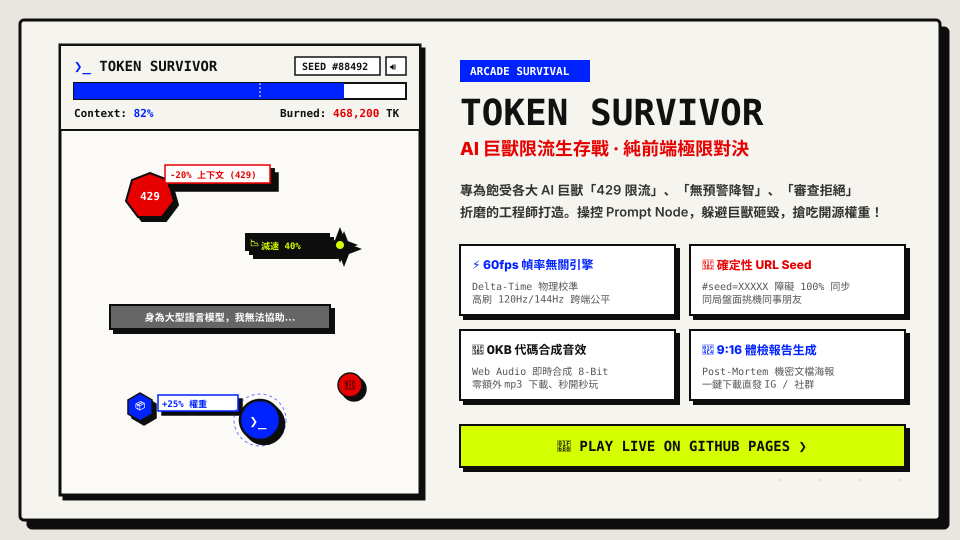

# ❯_ TOKEN SURVIVOR (AI 巨獸限流生存戰)

<p align="center">
  <a href="https://tonnychiulab.github.io/token-survivor/">
    
  </a>
</p>

<p align="center">
  <a href="https://tonnychiulab.github.io/token-survivor/"></a>
  <a href="https://github.com/tonnychiulab/token-survivor/blob/main/LICENSE"></a>
  <a href="#"></a>
  <a href="#"></a>
</p>

> **你能從 AI 巨獸的 429 限流、道德審查與靜默降智中存活超過 60 秒嗎？**  
> 一款純前端、零伺服器依賴、秒開秒玩、支援跨設備種子對決的硬派工程師諷刺生存遊戲。  
> 專為飽受各大 AI 巨獸「429 Too Many Requests」、「無預警降智」、「重置遙遙無期」折磨的開發者打造。

---

## 🎮 立即線上體驗 (Play Online)

- 🌐 **官方 GitHub Pages 線上版**：[https://tonnychiulab.github.io/token-survivor/](https://tonnychiulab.github.io/token-survivor/)
- 📦 **單檔免伺服器離線版**：[https://tonnychiulab.github.io/token-survivor/token-survivor-standalone.html](https://tonnychiulab.github.io/token-survivor/token-survivor-standalone.html)

---

## ⚡ 遊戲玩法與規則

操控核心節點 **[Prompt Node]**，在不斷燃燒 Context Window 的極限情境下穿梭求生：

| 元素 | 類型 | 影響效果與生存策略 |
| :--- | :---: | :--- |
| **❯_ Prompt Node** | **玩家本體** | 支援手機單指觸控拖曳與滑鼠精準操控，平滑插值跟隨手勢。 |
| **Context Window** | **核心血條** | 隨時間因 Token 洩漏而自然下降，歸零時觸發「額度耗盡」GameOver。 |
| **429 巨石** | **致命障礙** | 巨獸限流無情重擊，**扣除 20% Context Window**。 |
| **📉 靜默降智** | **負面狀態** | 高速穿梭射線，**強制減速 40% (持續 2.5 秒)** 並微幅扣除血量。 |
| **道德審查牆** | **阻擋障礙** | 橫向巨木屏障，印有「身為大型語言模型...」等經典拒絕台詞。 |
| **📦 開源權重** | **增益補給** | 拾取資源，立即**大幅回補 +25% Context Window**。 |
| **🔑 外流 API Key** | **終極道具** | 稀有資源，啟動 **5 秒超頻無敵狀態 + 強力磁鐵**，可直接粉碎巨獸障礙！ |

---

## 🌟 核心工程亮點

1. **⚡ 幀率無關物理引擎 (Frame-Rate Independent Physics)**
   - 全面依據 Delta Time (`dt * 60`) 校準實體位移與磁吸計算。
   - 保證傳統 60Hz 螢幕與 120Hz/144Hz 電競與旗艦手機（iPhone ProMotion）具備**完全相同的物理下落速度與公平性**。
2. **🎲 確定性 URL Seed 競技對決 (Deterministic Seed Trial)**
   - 網址攜帶 `#seed=XXXXXX`，保證所有障礙物與道具下落的時間軸與軌跡 **100% 相同**。
   - 分享連結給同事或社群，即是「挑戰同一局盤面」，公平較量存活秒數。
3. **🎵 純代碼 Web Audio 合成器 (0 KB Extra Assets)**
   - **0 KB 額外音效檔下載**！使用原生 Web Audio API 即時運算 8-bit 波形合成（受傷、拾取、無敵與 Game Over）。
   - 內建持久化靜音開關（狀態自動儲存於 `localStorage`）。
4. **📄 9:16 Brutalist 戰績體檢海報**
   - 純前端 Canvas 即時渲染一張 1080x1920 的矽谷機密文檔風格海報，一鍵下載直發 IG 限動與 X/Twitter！
5. **🛡️ 嚴格雙軌安全防護**
   - 內建嚴格 Content-Security-Policy (CSP) 與 Referrer-Policy，杜絕任何外部注入風險。

---

## 🛠️ 本機開發與測試

```bash
# 安裝開發依賴
npm install

# 啟動本地 Vite 開發伺服器
npm run dev

# 執行自動化測試 (Vitest - 10/10 Passed)
npm test

# 執行 TypeScript 型別檢查
npm run typecheck

# 建置生產環境代碼與單檔獨立 HTML
npm run build
```

---

## 📑 專案規範與契約

- 📜 **[程式碼審查契約 (Code Review Contract)](./docs/CODE_REVIEW_CONTRACT.md)**：明訂二輪審查上限、P0~P3 分級阻斷標準與檢核不變量。
- 📋 **[完整產品規格書 (SPEC)](./docs/SPEC.md)**：包含全套敏捷用戶故事（US1~US18）與驗收標準。
- 🔍 **[資安稽核報告 (Security Audit Report)](./docs/security-audit-20261103.md)**：涵蓋 CSP、儲存與資源防禦之安全分析。

---

## 📄 授權條款 (License)

本專案採用 [MIT License](./LICENSE) 開源授權。
