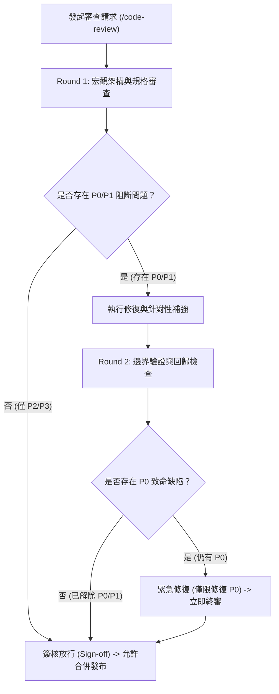

# 📜 程式碼審查契約 (Code Review Contract)

本文件定義 `Token Survivor` 專案之原始碼審查標準協定。旨在確立**明確的審查邊界、量化退出條件（Exit Criteria）、避免審查疲勞與無止境的邊際效益遞減**，確保軟體交付兼具極致品質與高效節奏。

---

## 🎯 一、 核心原則 (Core Philosophy)

1. **二輪封頂原則 (Max 2-Round Policy)**：原始碼審查至多進行 2 輪，禁止無休止的來回辯論。
2. **分級阻斷原則 (Severity Gating)**：僅有致命或重大瑕疵（P0/P1）得以阻擋版本發布，其餘項目限時轉為技術債清單（Tech Debt Backlog）。
3. **契約化檢核清單 (Invariant Checklist)**：過往踩過的教訓必須固化為硬性自動化檢核項，不再依賴審查者的隨機專注力。

---

## 🔄 二、 審查輪次與退出機制 (Review Cycles & Exit Criteria)

### 1. 第一輪審查 (Round 1: Architecture & Specification)
- **審查重點**：
  - 模組邊界劃分與依賴反轉（避免 Feature Envy）。
  - 核心規格符合度（Spec Compliance）。
  - TypeScript 型別嚴格性與單元測試覆蓋率。
- **產出**：具備日期與版本號的初步審查報告，條列 P0~P3 項目。

### 2. 第二輪審查 (Round 2: Verification & Edge Cases)
- **審查重點**：
  - 僅針對 Round 1 所列之 P0/P1 修正進行針對性回歸驗證。
  - 微觀邊界條件（Edge Cases）與過渡相容層清理。
- **強制終止線 (Hard Stop)**：
  - Round 2 結束後，**若無 P0 缺陷，必須立即簽核放行（Sign-off）**。
  - 嚴禁在 Round 2 提出全新的 P2/P3 風格爭議作為阻擋發布之理由。

---

## 🚦 三、 瑕疵嚴重性分級矩陣 (Severity Matrix)

| 等級 | 嚴重性定義 | 具體判定範例 | 處置與發布條件 |
| :---: | :---: | :--- | :--- |
| **P0** | **阻斷發布 (Blocker)** | 系統崩潰、安全防禦缺失（CSP 破損）、跨設備物理失衡（如漏乘 `dt` 導致高刷螢幕難度暴增）。 | **不可發布**。必須立即修復並建立自動化防禦測試。 |
| **P1** | **重大瑕疵 (Major)** | 核心數值規格偏差（如減速比例錯誤）、明顯記憶體洩漏、重大效能退化。 | 當次修復；或由專案維護者書面簽核承諾於次一小版本修補。 |
| **P2** | **次要瑕疵 (Minor)** | 重構後舊 Shim 檔案未清除、未使用的區域變數、行動端防止下拉重整宣告缺失。 | **不阻擋發布**。得併入當次發布，或登記至技術債待辦。 |
| **P3** | **微型優化 (Trivial)** | 變數命名品味、註解文字潤飾、程式碼排版美化。 | **禁止阻礙發布**。建議由 Linter / Prettier 自動規範處理。 |

---

## 🛡️ 四、 不變量硬性檢核清單 (Invariant Checklist)

任何審查在 Round 1 必須嚴格逐項通過以下硬性檢核：

### 1. 物理與時間步長不變量 (Physics & Delta Time Invariant)
- [ ] 物理位移計算：所有實體（Player、Hazards、Collectibles）之位置變更皆乘上 `dt`（或 `dt * 60` 基準歸一化）。
- [ ] 磁吸與動態插值：磁鐵吸附或平滑移動計算必須具備幀率無關性（Frame-Rate Independent）。
- [ ] 跨頻率自動測試：必須包含 `60Hz vs 120Hz` 跨刷新率之模擬對比測試，確保跨設備競賽公平性。

### 2. 模組重構純淨度不變量 (Refactoring Hygiene Invariant)
- [ ] 舊碼清除：模組化重構完成後，必須徹底清除根目錄之過渡轉接轉發檔（Shims），不得殘留重複實現。
- [ ] 依賴單向性：核心引擎（`engine/`）嚴禁反向引用上層渲染器（`renderer/`）或音訊系統（`audio/`）。

### 3. 行動端與瀏覽器相容不變量 (Browser & Mobile Invariant)
- [ ] 手勢回彈阻絕：主頁面 CSS 必須宣告 `html, body { overscroll-behavior: none; }` 防止下拉重新整理。
- [ ] 觸控互動鎖定：遊戲畫布容器必須宣告 `touch-action: none;` 與 `user-select: none;`。

### 4. 縱深防禦與安全不變量 (Security Invariant)
- [ ] 內容安全策略 (CSP)：HTML `<head>` 必須內嵌嚴格的 CSP 與 Referrer-Policy 宣告。
- [ ] CI/CD 最小權限：GitHub Actions workflow 必須明訂最小所需 permissions。

---

## 📝 五、 審查報告存檔規範 (Archival Standard)

所有正式審查報告必須遵守下列格式留存於版本庫：
1. **存放路徑**：`docs/code-review-YYYYMMDD-vX.Y.Z.md`
2. **必要章節**：
   - 審查輪次（Round 1 或 Round 2）。
   - 審查雙軸（Standards 規範軸 vs Spec 規格軸）。
   - 依 P0 ~ P3 分級條列之 Findings。
   - 簽核判定結論（PASS / CONDITIONAL PASS / BLOCKED）。

---

*本契約經由專案工程團隊簽署，自 v0.2.2 起作為所有自動化 Agent 與人工審查之唯一強制準則。*
